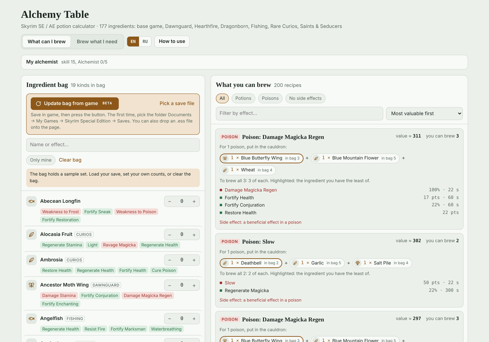
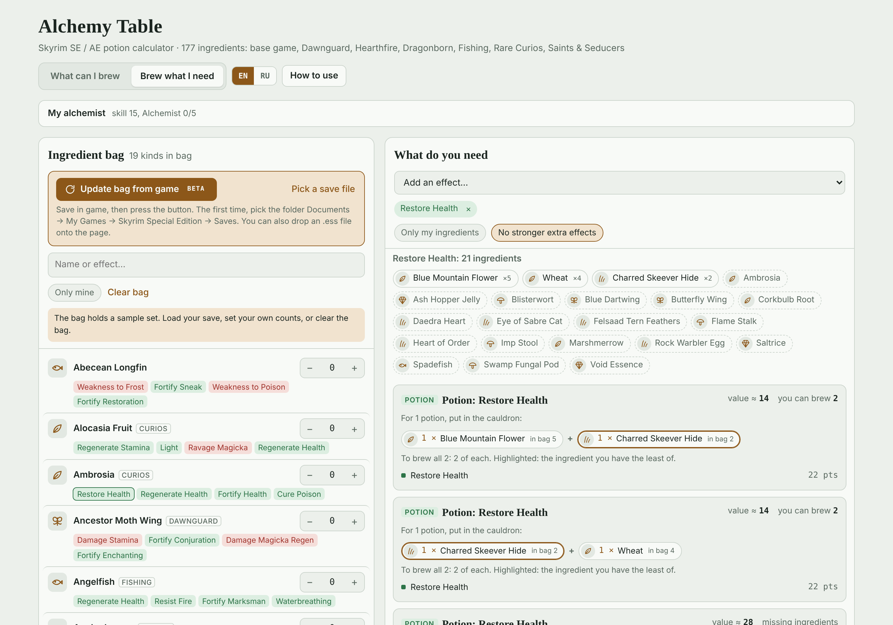

# Alchemy Table

**A potion calculator for Skyrim Special Edition and Anniversary Edition.** You can load your ingredient bag straight from your save file, and the page shows every potion and poison you can brew right now. It can also find the best recipe for the effects you want.

**[Open Alchemy Table →](https://gnomcgi.github.io/alchemy-table/)** · [Русская версия README](README.ru.md)

## Features

- **What can I brew.** Lists every potion and poison your current bag can make, sorted by value, by batch count or by number of effects. Each card shows what goes into the cauldron, how many you can brew and which ingredient runs out first.
- **Brew what I need.** Pick up to three effects and see which ingredients carry them, plus the best combinations. Recipes you can brew right now are listed first.
- **Bag from your save (beta).** Reads your newest `.ess` save and fills the bag in one click. It also sets your Alchemy skill and alchemy perks. It works with any load order and with mods installed.
- **Your alchemist.** Set your Alchemy skill, the Alchemist perk rank, Physician, Benefactor, Poisoner, Purity and any Fortify Alchemy gear. Skill and perks come from your save automatically. Strength and value are calculated with the game's own formulas.
- **177 ingredients** from the base game, Dawnguard, Hearthfire and Dragonborn, plus the Creation Club Fishing, Rare Curios and Saints & Seducers content (all part of Anniversary Edition). The data was extracted from the game files.
- **English and Russian**, with official in-game names. You can switch language at any time.
- **Private and offline.** It's a single HTML file with no account and no server. Your files never leave your computer.

## How to use

1. Open the [web version](https://gnomcgi.github.io/alchemy-table/), or download `index.html` (from this repo or from Nexus) and open it in your browser.
2. Save your game, then press **Update bag from game**. The first time, pick the folder `Documents\My Games\Skyrim Special Edition\Saves` (GOG: `Skyrim Special Edition GOG\Saves`). The picker shows folders only, so you won't see the save files themselves. That's expected.
   - **Chrome / Edge:** pick the folder once. Right after that, and when you open the page again later, the browser asks for permission to access the Saves folder ("view and edit files" in some versions). Choose **Allow on every visit**, and from then on one click reads the newest save. The page only reads saves and never changes them.
   - **Firefox:** pick the folder each time. Alternatively, use **Pick a save file**, or drag an `.ess` file onto the page.
3. Check **My alchemist**: skill and perks are already filled from the save. Add Fortify Alchemy from your gear if you have any.
4. Browse **What can I brew**, or switch to **Brew what I need** and pick the effects you want.

You can also skip the save import entirely and set counts by hand with the + and − buttons.

## Save import (beta): what to expect

- Supports Skyrim **Special Edition / Anniversary Edition** saves (Steam and GOG). Legendary Edition (Oldrim) saves are not supported.
- Ingredients from the base game, the DLCs, Fishing, Rare Curios and Saints & Seducers are recognized. Ingredients added by other mods are skipped.
- The tool reads the save file, not the running game, so save first.
- If the counts don't match your in-game inventory, please [open an issue](https://github.com/GnomCGI/alchemy-table/issues) and attach the save. That's the fastest way to fix it.

## Known limits

- Mods that rework alchemy (CACO, Requiem and similar) change the formulas and ingredients, and they aren't accounted for.
- Strength and value can differ from the game by 1 because of rounding.
- Your bag and settings are stored in the browser's local storage for this page only.

## For developers

- `index.html` is the whole app: plain HTML, CSS and JS, with no build step and no dependencies. Google Fonts are optional and have system fallbacks.
- `tools/extract_data.py` rebuilds the ingredient and effect data from your own game install (the ESM/ESL plugins and the localized strings inside the BSAs). See the header of that file for usage.

## License

[MIT](LICENSE). Alchemy Table is an unofficial fan tool and is not affiliated with Bethesda Softworks or ZeniMax Media. *The Elder Scrolls* and *Skyrim* are trademarks of ZeniMax Media Inc. The game data in this tool (ingredient names, effects and values) belongs to its owners and is used only to make the calculator work.

If the tool saved you some time, an endorsement on Nexus helps other players find it.
