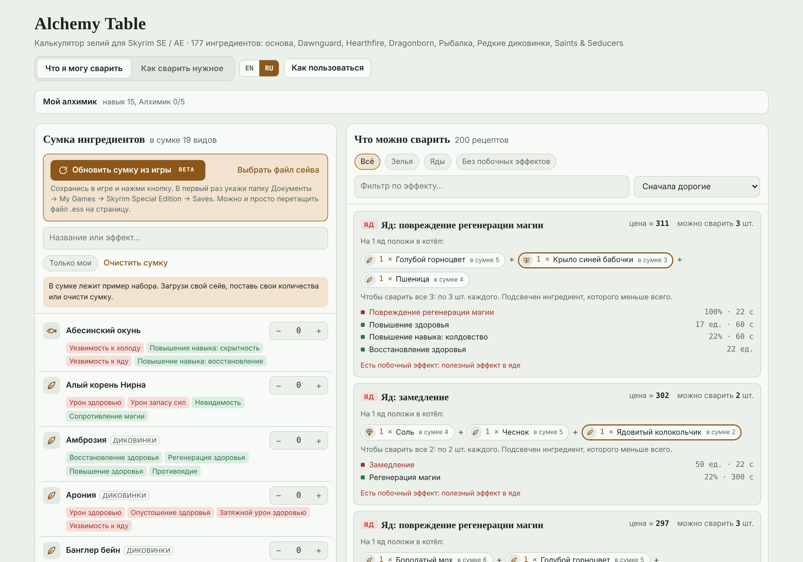

# Alchemy Table

**Калькулятор зелий для Skyrim Special Edition и Anniversary Edition.** Сумку с ингредиентами можно загрузить прямо из сейва. Страница покажет все зелья и яды, которые можно сварить прямо сейчас, и подберёт лучший рецепт под нужные эффекты.

**[Открыть Alchemy Table →](https://gnomcgi.github.io/alchemy-table/)** · [English README](README.md)

## Что умеет

- **Что я могу сварить.** Список всех зелий и ядов из текущей сумки. Сортировка по цене, по числу партий или по количеству эффектов. На карточке видно, что положить в котёл, сколько штук получится и какой ингредиент кончится первым.
- **Как сварить нужное.** Выбираешь до трёх эффектов и видишь ингредиенты с ними и лучшие сочетания. Рецепты, которые можно сварить прямо сейчас, идут первыми.
- **Сумка из сейва (бета).** Читает самый свежий сейв `.ess` и заполняет сумку одним кликом. Заодно выставляет навык алхимии и перки алхимии. Работает с любым порядком загрузки и с модами.
- **Мой алхимик.** Навык, ранг перка «Алхимик», Врач, Благодетель, Отравитель, Чистота и усиление алхимии от экипировки. Навык и перки подтягиваются из сейва сами. Сила и цена зелий считаются по формулам самой игры.
- **177 ингредиентов**: основная игра, Dawnguard, Hearthfire, Dragonborn и контент Creation Club «Рыбалка», «Редкие диковинки» и Saints & Seducers (всё это входит в Anniversary Edition). Данные извлечены из файлов игры.
- **Английский и русский** с официальными игровыми названиями. Язык переключается в любой момент.
- **Приватно и офлайн.** Это один HTML-файл: без аккаунта и без сервера. Файлы не покидают твой компьютер.

## Как пользоваться

1. Открой [веб-версию](https://gnomcgi.github.io/alchemy-table/) или скачай `index.html` (из репозитория или с Nexus) и открой его в браузере.
2. Сохранись в игре и нажми **Обновить сумку из игры**. В первый раз укажи папку `Документы\My Games\Skyrim Special Edition\Saves` (GOG: `Skyrim Special Edition GOG\Saves`). В окне выбора видны только папки, а сами сейвы нет, так и должно быть.
   - **Chrome / Edge:** папку выбираешь один раз. Сразу после выбора и при следующих заходах браузер спрашивает разрешение на доступ к папке Saves (в некоторых версиях там написано «просмотр и редактирование файлов»). Выбери **Разрешать при каждом посещении**, и дальше один клик читает самый свежий сейв. Страница только читает сейвы и ничего в них не меняет.
   - **Firefox:** папку нужно выбирать каждый раз. Есть и другие способы: **Выбрать файл сейва** или перетащить файл `.ess` на страницу.
3. Загляни в **Мой алхимик**: навык и перки уже подтянуты из сейва. Если на тебе есть экипировка с усилением алхимии, добавь его вручную.
4. Смотри **Что я могу сварить** или переключись на **Как сварить нужное** и выбери эффекты.

Импорт из сейва необязателен: количества можно поставить вручную кнопками + и −.

## Импорт из сейва (бета): чего ожидать

- Поддерживаются сейвы **Special Edition / Anniversary Edition** (Steam и GOG). Сейвы Legendary Edition (старого Skyrim) не поддерживаются.
- Распознаются ингредиенты основной игры, DLC, «Рыбалки», «Редких диковинок» и Saints & Seducers. Ингредиенты из других модов пропускаются.
- Читается файл сейва, а не запущенная игра, поэтому сначала сохранись.
- Если количества не совпадают с инвентарём в игре, [создай issue](https://github.com/GnomCGI/alchemy-table/issues) и приложи сейв. Так исправить быстрее всего.

## Ограничения

- Моды, переделывающие алхимию (CACO, Requiem и похожие), меняют формулы и ингредиенты и здесь не учитываются.
- Сила и цена могут отличаться от игровых на 1 из-за округления.
- Сумка и настройки хранятся в локальном хранилище браузера, только для этой страницы.

## Для разработчиков

- `index.html` и есть всё приложение: чистые HTML, CSS и JS, без сборки и без зависимостей. Google Fonts необязательны, без них используются системные шрифты.
- `tools/extract_data.py` пересобирает данные ингредиентов и эффектов из твоей установленной игры (плагины ESM/ESL и локализованные строки из BSA). Как запускать, написано в начале файла.

## Лицензия

[MIT](LICENSE). Alchemy Table — неофициальный фанатский инструмент, он не связан с Bethesda Softworks и ZeniMax Media. *The Elder Scrolls* и *Skyrim* являются товарными знаками ZeniMax Media Inc. Игровые данные (названия ингредиентов, эффекты, значения) принадлежат их владельцам и используются только для работы калькулятора.

Если инструмент сэкономил тебе время, поставь endorsement на Nexus: так его найдут другие игроки.
